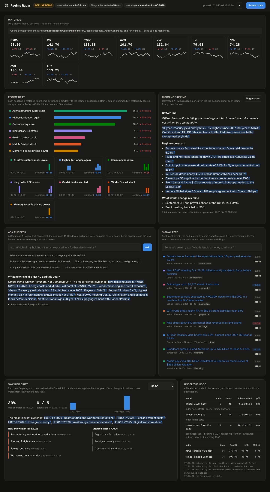
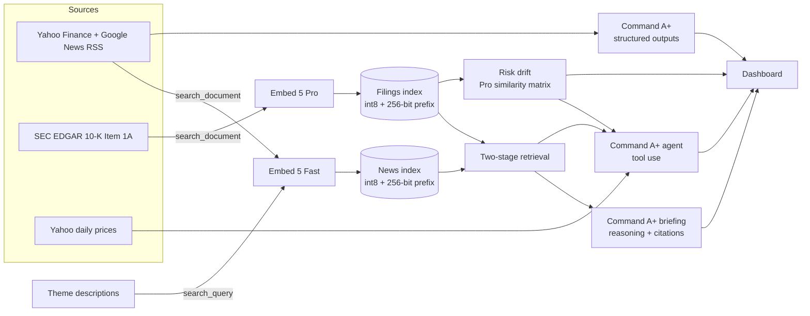

# Regime Radar

**A market-intelligence dashboard for the 2026 macro regime, built on Cohere Embed 5 and Command A+.**

Markets in autumn 2026 are being driven by a few large forces at once. The Fed started hiking again in September (to 3.75–4.00%). The 10-year Treasury yield is at its highest level since 2007. Brent is above $100 on U.S.–Iran tensions, gold is above $4,000, and AI infrastructure is being financed with record funding rounds and chip-leasing deals. Regime Radar tracks how news flow and corporate risk disclosures line up with each of those forces. It scores, cites and explains everything it shows, and it shows you which model call produced each piece.



---

## What it does

| Panel | What you see | How it's built |
|---|---|---|
| **Regime heat** | Seven 2026 themes ranked by a heat score, with momentum and a 21-day timeline for each | Headlines matched to natural-language theme descriptions by **Embed 5** similarity, with no keyword lists. Heat is materiality scored by **Command A+** with a 7-day decay |
| **Signal feed** | Every headline tagged with sentiment, event type, materiality and tickers, plus semantic search | **Command A+ Structured Outputs** (JSON Schema) on batches of headlines, and **Embed 5** search across the news and 10-K indexes together |
| **Morning briefing** | A cross-asset briefing in which every claim links back to its source | Theme-targeted retrieval feeds **Command A+** with **reasoning** (a 2,048-token thinking budget), and the output carries **native citations** |
| **Ask the desk** | A research agent you can question in plain English, with the full tool trace shown | **Command A+ multi-step tool use** across 5 local tools (vector search, price stats, correlation, theme exposure, 10-K diff). Tool outputs come back as documents, so the answer cites them |
| **10-K risk drift** | Risk factors that are new this year and ones that were dropped, compared with the prior 10-K | Item 1A paragraphs embedded with **Embed 5 Pro**, a year-over-year similarity matrix, and novelty ranking. **Command A+** then explains the change with citations |
| **Under the hood** | Calls, tokens and p50 latency for each model and feature, plus index memory | A per-call telemetry wrapper, and storage stats for float32, int8 and binary |

## How the models are used

**1. Fast and Pro are routed by workload, using their shared embedding space.**
`embed-v5.0-fast` indexes the high-volume, constantly refreshed news stream. `embed-v5.0-pro` indexes long-form 10-K legal prose, where quality matters more than throughput. The two models share an embedding space, so the app embeds a query once with Fast and searches both indexes with that single vector. A theme's anchor vector can therefore score a headline and a 10-K paragraph on the same scale. `scripts/eval_retrieval.py` measures what this cross-model search costs (configuration D compared with E).

**2. Matryoshka embeddings and quantization are used for cheap retrieval.**
Each document is stored in two forms:
- an **int8** copy of the full 2048-d vector (4× smaller than float32), used for exact rescoring
- a **binary** copy of the 256-d Matryoshka prefix (**32 bytes per document**, 256× smaller), used for a Hamming-distance first pass

Search takes a shortlist from the binary prefix and rescores it with int8 cosine. The eval script reports how much recall each of these compressions gives up.

**3. Input types are asymmetric.**
Documents are embedded as `search_document`. Queries and theme descriptions are embedded as `search_query`.

**4. Each Command A+ call is configured for its job.**

| Call | `thinking` | Other features |
|---|---|---|
| Headline enrichment | disabled (fast, cheap) | `response_format` JSON Schema, temperature 0 |
| Briefing | `token_budget: 2048` | `documents`, citations |
| Agent | `token_budget: 1024` | `tools`, multi-step loop, tool results returned as cited documents |
| Risk-drift summary | `token_budget: 512` | `documents`, citations |

**5. Every claim can be traced to a source.**
Citations are character spans in the response. The UI highlights each span and opens the source document, or the raw tool output, when you click it.

## Architecture



```
radar/
  cohere_api.py     REST client for /v2/embed and /v2/chat: batching, retries, telemetry
  vectorstore.py    int8 + binary Matryoshka index, two-stage search, persistence
  themes.py         the seven 2026 regime themes (natural-language anchors)
  enrich.py         Structured Outputs schema for headline scoring
  briefing.py       retrieval-augmented briefing with reasoning and citations
  agent.py          tool definitions and the multi-step tool-use loop
  risk_drift.py     year-over-year 10-K diff
  pipeline.py       Radar: ingest, index, theme scoring, analytics
  server.py         stdlib HTTP server and JSON API
  mock_cohere.py    deterministic offline stand-in that returns the real v2 response shapes
  sources/          RSS, Yahoo chart and SEC EDGAR fetchers
web/                vanilla JS dashboard with hand-written SVG charts and light/dark themes
scripts/            retrieval eval
tests/              offline unit and integration tests
```

There is no framework and no build step. The only runtime dependencies are `requests` and `numpy`.

## Quick start

```bash
git clone https://github.com/<you>/regime-radar && cd regime-radar
python -m venv .venv && source .venv/bin/activate
pip install -r requirements.txt

cp .env.example .env        # then paste your COHERE_API_KEY (and optionally SEC_USER_AGENT)
python -m radar.server      # open http://127.0.0.1:8787
```

**No key?** Run `python -m radar.server --demo`. Demo mode runs fully offline on a bundled snapshot of early-October 2026 headlines, with deterministic mock models. In that mode, prices are clearly labeled synthetic series and the 10-K examples come from fictional companies. Every UI path works, but the text is template-generated rather than written by Command A+.

**Run the tests and the eval:**

```bash
python -m unittest discover -s tests -v
python -m scripts.eval_retrieval          # with COHERE_API_KEY set, for real numbers
```

## Configuration

| Variable | Default | Purpose |
|---|---|---|
| `COHERE_API_KEY` | — | Required for live mode |
| `CHAT_MODEL` | `command-a-plus-05-2026` | Generative model |
| `EMBED_MODEL_FAST` / `EMBED_MODEL_PRO` | `embed-v5.0-fast` / `embed-v5.0-pro` | Embedding models |
| `COARSE_DIM` | `256` | Size of the Matryoshka prefix used for the binary first pass |
| `WATCHLIST` | `NVDA,MU,AVGO,XOM,GLD,TLT,NKE,ACN,SPY` | Price tiles and per-ticker news feeds |
| `FILINGS_TICKERS` | `NVDA,MU,XOM,NKE` | Companies whose 10-K risk factors are indexed |
| `SEC_USER_AGENT` | — | Contact string that EDGAR requires, e.g. `Jane Doe jane@example.com` |

## Notes and limits

- Live news comes from public RSS feeds and Yahoo's unofficial chart endpoint. Both are fine for a personal project, but neither is a licensed market-data feed.
- The demo-mode headlines are short paraphrases of public reporting from September and October 2026, and each one links to its source. The demo 10-K companies (Northwind Semiconductor and Harbor Outfitters) are fictional.
- Nothing here is investment advice.

## License

MIT
